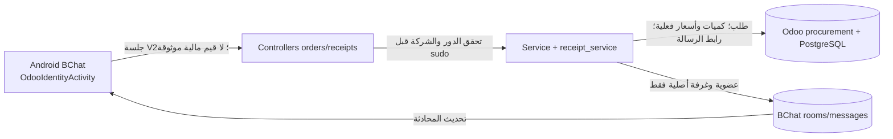

# BChat — مراجعة الطلبات والاستلام والشركات (2026-10-14)

## G0 — عقد البناء

- المستخدم: مشغّل طلبات BChat مخوّل في شركة أو أكثر داخل أودو. المطلوب: أدوات كمية واضحة، اسم صنف بلا رمز داخلي في الاستلام، تحميل مستقر، اختيار شركة يدوم عبر الجلسات، عرض طلبات الشركات المصرح بها، وترتيب شركة متسق مع المحادثات.
- القبول: تظهر «كل الطلبات» المنشأة من BChat لجميع الموظفين عبر جميع شركات المستخدم المخوّل بها مع اسم الشركة وصاحب الطلب لكل صف وترقيم صفحات واحد؛ لا تظهر أي شركة أو طلب خارج صلاحية مشغّل الطلبات، ولا يتغير إنشاء الطلب أو استلامه أو المبلغ والمخزون. اختيار الشركة النشطة يخص المنيو والاستلام وإنشاء الطلب، ولا يرشّح القائمة المجمّعة؛ يستعاد بعد إغلاق التطبيق أو الخروج والدخول بالحساب نفسه بعد التحقق من بقائه ضمن شركات الجلسة الحالية، ويزال عند تبديل حساب/خادم أو سحب صلاحية الشركة. عناصر الكمية لا تغير حساب السعر المحلي، وتظل حدود الإدخال والتحقق الخلفي قائمة. الاستلام يعرض اسم الصنف بلا `default_code`. القائمة المتطابقة للشركات لا تغير صلاحيات أودو.
- حسم المالك النطاق: **طلبات جميع الموظفين** في جميع الشركات المصرح للمستخدم بها. افتراض القناة الحالي هو طلبات BChat (`source_channel=bchat`) القائمة في هذا القسم؛ إدخال طلبات أودو المنشأة من قنوات أخرى خارج هذا التغيير حتى يثبت عقدها، ولا يختلط بإنشاء/تأكيد الاستلام.
- خارج النطاق: تغيير سياسة السعر أو الاستلام أو المخزون، توسيع صلاحيات مستخدم غير مشغّل، نشر QA/Live، واختبار حمل على بيئة مشتركة.
- خريطة دورة ERP: أودو يملك الشركات والعضوية والطلب والسعر والإجمالي وحالة الاستلام؛ Android يختار سياق الإدخال ويعرض استجابات الخادم. عرض سجل الطلبات لا ينشئ مستندًا ولا حركة مخزون.
- المصدر المجمد لواجهة Android: `5060eedb` في `codex/bchat-orders-ui-20261014`. خدمة `baseer_bchat_procurement` الموجودة في خادم BChat المحلي غير متتبعة في Git، لذلك لا يبدأ تعديلها أو إصدارها حتى جرد المصدر وإدخاله إلى فرع وPR معتمدين. لا نسخ إلى ملفات QA/Live.

## G1 — السعة والاستمرارية

- الحجم الفعلي وزمن الشبكة غير مقاسين. حد الشركات الحالي 20، وصفحة الطلبات 30، والمنيو 24، والاستلام 30. لا شهادة سرعة قبل قياس كل مرحلة على جهاز/بيئة محلية مأذونة.
- مسار البطء المرصود من الكود: `options` عام ثم خيارات الشركة ثم بيانات الوضع، كلها تسلسلية في قناة V2 واحدة مع تأجيل 500ms عند الانشغال، وإعادة تحميل عند لمس تبويب الطلبات النشط أو وصول حدث تغيير. كتالوج الخادم قد يفعّل إنشاء خيارات افتراضية وقفل صفوف منتجات أثناء القراءة. يجب فصل قياس العميل والشبكة والخادم/SQL قبل ادعاء السبب الزمني.
- العرض المجمّع يستخدم صفحة واحدة وحدًا ثابتًا مع مؤشر `id desc` شاملًا للشركات، لا طلبًا لكل شركة ولا تحميل كل السجل. عند تغيّر الصلاحية لا تُعرض ذاكرة شركة لم تعد مسموحة.
- زيادة عدد الموظفين لا تغيّر حد الصفحة: 30 طلبًا/استدعاء و`id < before_id` لجميع الشركات معًا. حجم الاستخدام الفعلي وزمن استجابة الخادم غير مقاسين؛ لا يُضاف فهرس مركّب قبل فحص خطة استعلام ببيانات آمنة تمثل الحجم الحقيقي. الهدف الوظيفي أن لا يُحمّل التطبيق صفحات كل شركة تسلسليًا، وأن يظهر الاسم/الشركة من الصفحة نفسها. لا توجد كتابة أو أثر محاسبي من القراءة الجديدة.

## G2 — ملكية البيانات والعقد

- عقد العرض المجمّع **أُعيد فتحه عند G2** بعد توضيح المالك. يظل `GET /orders?company_id=N` القديم مقيدًا بمنشئ الطلب كما كان، والطلب بلا `company_id` أو نطاق صريح يظل مرفوضًا. يضيف `GET /orders?scope=all` قائمة طلبات BChat لجميع الموظفين داخل اتحاد شركات المستخدم التي تحقق الخادم من قراءتها، وبعد التحقق من دور مشغّل الطلبات وجلسة فردية وقبل أي `sudo`؛ لا تُقبل قائمة شركات من Android. لا يغير هذا العقد إنشاء الطلب أو تأكيد الاستلام.
- كل صف في النطاق الجديد يعيد `company_id` واسم الشركة و`requester_id` و`requester_name` مع حقول الطلب القائمة، بحد 30 طلبًا ومؤشر `id desc` عالمي ثابت. `requester_id` يأتي من أودو ولا يُستنتج من الاسم. تفاصيل طلب زميل تتطلب `scope=all` صريحًا و`company_id` الخاص بالصف مع تحقق دور المستخدم والشركة على الخادم؛ ترد التفاصيل بـ`requester_id` نفسه، ولا يُستخدم اختيار شركة الهيدر لذلك. تبقى تفاصيل العميل القديم لمنشئ الطلب فقط. لا تعرض قائمة شركة غير مصرح بها ولا طلبات قناة أخرى. يرفض الخادم الجمع بين `scope=all` و`company_id` في طلب القائمة، وأي نطاق غير معروف.
- نموذج أودو يملك `company_id index=True` و`source_channel index=True` وPK `id`، ولا يفترض هذا العقد إضافة فهرس قبل قياس. استجابة الصف متعدد الشركات تُقرأ بـ`with_company(order.company_id)` حتى لا تأخذ عملة أو سياق شركة الهيدر. لا يُرجع API سجلًا بلا شركة أو مستخدم أو قناة صالحة. الحد الحجمي للاستجابة يراجع في الاختبار مثل بقية عقود BChat.
- مسار snapshot لتغيّر قسم الطلبات في `baseer_bchat/models/change.py` يعرض أصلًا طلبات BChat لجميع الموظفين بـ`company_id in user.company_ids`؛ يُعدّل في الشريحة نفسها ليتحقق من قراءة كل شركة بـ`_company_scope` قبل `sudo` ويستعمل اتحاد الشركات المتحقّق منها فقط. يحتفظ بدوره snapshot/hints لا مصدر تفويض مستقل للتفاصيل؛ الحقول الإضافية للصف تأتي من serializer المشترك، ولا تُستخدم لاستنتاج صلاحية إنشاء أو استلام.
- إعادة الإرسال إلى المحادثة تبقى لطلبات المستخدم نفسه فقط في العميل: يقارن Android `requester_id` الموثوق من القائمة **والتفاصيل** بمعرّف الحساب الموثق، فيخفي/يعطّل الإجراء لطلب الزميل حتى لو أمكن قراءة تفاصيله. لا يتغير تفويض العضوية في غرفة المحادثة. مشاركة طلب الزميل تحتاج قرارًا منفصلًا. عند 403 للقائمة المجمّعة تُزال بياناتها ويُعاد تحقق الدور/الشركات، لا تُحظر شركة الهيدر اعتباطًا؛ 404 للتفاصيل لا يعرض بيانات قديمة.
- فحص Odoo وAndroid قبل التنفيذ: صلاحية دور operator، الوصول عبر شركات المستخدم فقط، مستخدم بلا دور، شركة مسحوبة، طلب موظف آخر داخل شركة مسموحة، طلب خارج الشركات، طلب قناة غير BChat، مؤشر الصفحة على شركتين، الاستجابة القديمة، تفاصيل طلب الزميل، عدم تسرب الإجمالي/الاسم عبر أخطاء 403/404، وحالة تغيير الشركة بعد فتح القائمة. خطوات «إعادة الإرسال إلى المحادثة» وسواها تبقى بحدودها الحالية حتى يثبت أنها قراءة محضة أو تُحرس منفصلة.
- أسماء الاستلام تُسلسَل من `product.name` مثل الكتالوج، لا تقصّ الواجهة النص الموروث من `display_name` لأن الرمز قد يكون جزءًا مشروعًا من اسم آخر.
- مفتاح حفظ الشركة مرتبط بحساب/خادم BChat لا بجهاز عام. يتحقق التطبيق من الشركة المحفوظة مقابل قائمة الخادم في كل دخول، ويختار بديلًا آمنًا إن زالت الصلاحية. طلبات جميع الشركات لا تخضع للشركة النشطة.
- عقود التراجع: العميل القديم مع `company_id` يستمر؛ العميل الجديد لا يتطلب ترقية قاعدة بيانات. اختبارات عزل شركة غير مصرح بها، مستخدم بلا دور، انتقال شركة، مؤشر الصفحة، وتغيّر الصلاحية مطلوبة.

### قرار معماري لإعادة فتح G2

المسار المباشر هو نطاق قراءة صريح داخل خدمة أودو القائمة، لا طلبات مستقلة لكل شركة في Android ولا صلاحية أودو عامة جديدة. دور مشغّل BChat الحالي يجيز الاطلاع التشغيلي داخل شركاته، وهو نفسه الذي يرى قائمة الاستلام وتلميحات تغيّر الطلبات؛ لا يُعطى المستخدم غير المشغّل حقًا جديدًا. يبقى `company_id` القديم وصاحبه فقط للتوافق، بينما `scope=all` هو بوابة القراءة الجديدة. هذا قرار قراءة فقط؛ لا يزيد صلاحية إنشاء أو اعتماد أو استلام أو إرسال رسالة باسم غيره.

## G3 — التقنية والمسار المباشر

- Android Java و`Ui` ونصوص العربية/الإنجليزية القائمة، دون مكتبة أو رصة جديدة. عنصر كمية واحد متخصص داخل صف الصنف، بحجم لمس لا يقل عن 48dp وأرقام 0–9، ويحافظ على القيمة الخام حتى اقتباس أودو.
- المسار الأقصر: توحيد مصدر وترتيب الشركات في رد الخادم، إزالة جولات الخيارات غير اللازمة عند الانتقال بين «طلباتي» والاستلام، وتوقيت كل مرحلة قبل تحسين الاستعلامات. لا cache للمبالغ أو الطلبات عبر الشركات دون نموذج إبطال واضح.
- الفحوص المناسبة: عقود Android وOdoo، عزل صلاحيات وشركات، ترقيم، RTL/EN وعرض 320dp، فحص عدم تغير إنشاء/استلام الطلب، ثم بناء APK واحد للهاتف والمحاكي. لا فحص حمل جديد قبل وجود قياس محلي يبرره وحجم استخدام المالك.

## G4 — مواصفة الواجهة المحدودة

- صف المنيو يضم اسم الصنف والتحكم بالكمية في مكوّن واحد بحد لمس 48dp؛ قيمة الكمية ظاهرة بأرقام 0–9، وإجراء الإضافة أو التعديل واضح من دون صف أزرار مشتت. لا حساب سعر محلي ولا مؤثرات حركة تعطل اللمس.
- الشركة النشطة محفوظة لكل حساب وخادم، وتُعاد مطابقتها مع قائمة الشركات المصرح بها قبل إظهار بيانات المنيو/الاستلام. قائمة الشركات مرتبة بالمعرّف تصاعديًا في المحادثات والطلبات. الحالات العربية والإنجليزية وRTL/LTR والعرض الضيق جزء من القبول.
- إزالة طلب شبكة مكرر عند لمس التبويب النشط أو إعادة الدخول إلى الوضع نفسه لا تمنع التحديث اليدوي الصريح ولا تغيّر ترقيم النتائج أو صلاحياتها.

## السجل الحي والبوابات

| الوقت | النية والنطاق | النتيجة/الدليل | البوابة |
| --- | --- | --- | --- |
| 2026-10-14 | قراءة مصدر Android وخدمة Odoo المحلية وسجل المعمارية دون تعديل بيانات | الواجهة تفصل أزرار الكمية؛ الاستلام يرسل `display_name`؛ خيارات الشركات بلا ترتيب موحد؛ الجلب تسلسلي؛ الطلبات شركة واحدة ولصاحبها؛ خدمة المشتريات غير متتبعة في Git | G0–G3 مسودة، بانتظار حارس مستقل |
| 2026-10-14 | إنشاء فرع عمل مستقل من مرشح واجهة الطلبات | `codex/bchat-orders-multicompany-20261014` من `5060eedb`؛ لم يُبن APK ولم يُنشر شيء | توثيق فقط |
| 2026-10-14 | مراجعة حارس بوابات مستقل لعقد G0–G3 | GO لتتبع موديول Odoo المحلي بعد الجرد، GO لإصلاح اسم الاستلام في serializer مع اختبار، GO لتعديل Android المستقل؛ NO-GO لواجهة الطلبات المجمّعة حتى حسم نطاق الرؤية وعقد G2/اختبارات العزل | G0–G3 جزئي؛ G2 المجمّع معلّق |
| 2026-10-14 | تنفيذ محلي محدود دون نشر | جرد 18 ملفًا من موديول المشتريات المحلي وإدخالها للمصدر؛ تعديل serializer الاستلام واختباره؛ Android: عنصر كمية موحّد، حفظ شركة حسب الحساب عبر إعادة الدخول، ترتيب موحّد، تقليل إعادة الخيارات، واسترداد حالة سحب شركة عند 403 | G4–G5 للجزء المأذون |
| 2026-10-14 | فحص موجّه ومراجعة مستقلة | 11 اختبار عقد Android نجحت، ترجمة Java نجحت، صياغة Python/XML واختبار عقد اسم الصنف نجحت؛ الحارس لم يجد P0/P1 في الفرق. لا اختبار أودو بقاعدة بيانات، ولا قياس جهاز/شبكة، ولا APK جديد، ولا فحص بصري 320dp لأن ADB لا يعرض جهازًا | GO لبناء محلي فقط؛ NO-GO للتسليم/QA/Live |

## الحدود المفتوحة

- حسم المالك طلبات جميع الموظفين؛ G2 للعقد الجديد قيد مراجعة الحارس المستقل، فلا يبدأ تنفيذ API قبل اعتماد حدود الرؤية والاختبارات أعلاه.
- مسار البطء له مسببات كودية مؤكدة، لكن مقدار أثر كل مرحلة غير مقاس؛ لا ادعاء بزمن استجابة قبل رصد محلي على جهاز متصل.
- الإصلاح الخادمي موجود في المصدر فقط. لا تُنسب إليه نتيجة تشغيل حاوية Odoo الحالية حتى ترقية محلية معتمدة واختبار مسار الاستلام.

## ملحق قرار المالك — إعادة فتح G0/G2

| الوقت | النية والنطاق | النتيجة/الدليل | البوابة |
| --- | --- | --- | --- |
| 2026-10-14 | حسم نطاق «جميع الطلبات» بسؤال واحد دون تغيير بيانات | اختار المالك «طلبات جميع الموظفين»، لا طلباته وحده؛ القرار يغيّر صلاحية قراءة القائمة والتفاصيل، لا صلاحية الإرسال والاستلام | G0 وG2 قيد المراجعة مجددًا؛ يمنع كود API حتى قرار الحارس |
| 2026-10-14 | مراجعة حارس البوابات للعقد المعاد فتحه | أوقف الكود مؤقتًا إلى حين تحديد `requester_id` للمشاركة وحدود snapshot؛ أضيف الشرطان إلى G2 دون تعديل للتطبيق | G2 قيد المراجعة؛ انتظار حكم نهائي |
| 2026-10-14 | اعتماد حارس البوابات المستقل للعقد المصحح | تحقق من `requester_id` في القائمة والتفاصيل، منع مشاركة طلب الزميل، تحقق snapshot قبل `sudo`، ونطاق `scope=all` الصريح مع استمرار المسار القديم لصاحب الطلب | GO للبناء المحلي فقط؛ لا DB أو QA/Live أو APK تسليم قبل الاختبارات ومراجعة التسليم |

## ملحق تصحيح دورة العمل — قرار المالك 2026-10-14 (G0–G3 قيد المراجعة)

- **G0/المستخدم والقبول:** مدير الفرع (`cashier` تقنياً) والكاشير (`pos_cashier`) اللذان منحا صلاحية BChat يطلبان، ويرسلان الطلب إلى غرفة الشركة، ثم يسجل أحدهما الكمية والسعر الفعليين ويؤكد الاستلام. مندوب المشتريات يقرأ الرسالة بصفته عضواً في الغرفة فقط؛ علامة `is_purchase_representative` لا تمنحه قسم الطلبات. المالك (`owner`) يرى طلبات جميع الموظفين في الشركات المسموحة له دون صلاحية إنشاء أو استلام من هذا المسار. نجاح مشاركة ملخص الاستلام يعني ظهور رسالة جديدة بالكميات والإجمالي **الفعليين** في الغرفة، لا إعادة نشر نص الطلب الأصلي.
- **G0/حدود التعديل:** لا إضافة صنف أو زيادة كمية فوق المطلوب في شاشة الاستلام الحالية؛ يظل تعديل الكمية المستلمة ضمن سقف الطلب والسعر الفعلي هو المسار المأذون. لا تمس قيود المخزون أو السعر المعتمد أو مستندات أودو القديمة خارج BChat. لا نشر أو تعديل بيانات QA/Live في مرحلة البناء.
- **G1/السعة والاستمرارية:** طلبات العرض 30/صفحة ومؤشر عالمي كما في العقد السابق. رسالة نتيجة الاستلام واحدة لكل عملية تأكيد، مع إعادة محاولة آمنة بعد فشل الشبكة، دون تكرار حركة المخزون أو الرسالة. أرقام المستخدمين والرسائل الفعلية غير مقاسة؛ لا اختبار حمل جديد بلا خطر محدد وحجم مالك فعلي.
- **G2/العقد والصلاحيات:** افصل إذن القراءة عن إذن التشغيل. `scope=all` وتفاصيله متاحان فقط للمالك ذي الدور المثبت أو لمشغّل BChat المصرّح له في شركاته، بعد تحقق `_company_scope` وقبل `sudo`. مسارات الإنشاء والاقتباس والكتالوج والاستلام تتطلب دور مدير/كاشير **مع** إذن BChat التشغيلي؛ لا يكفي دور المالك أو إذن القراءة وحدهما، ولا تمنح علامة المندوب أي حق API. يتلقى Android قدرة `viewer/operator` موثوقة من الخادم ليعرض للمالك قائمة قراءة فقط، وللمندوب لا قسم طلبات. يُزال كامل مخزون القائمة المجمعة ويعاد تحقق القراءة عند 403/404 في التفاصيل حتى لا تبقى طلبات شركة سُحبت صلاحيتها.
- **G2/الاستلام والمحادثة:** أودو يملك الحالة والكمية والسعر والإجمالي الفعلي. تأكيد الاستلام يبقى ذرياً ومستقلاً عن إرسال الرسالة. بعد تأكيد ناجح فقط يظهر إجراء مشاركة نتيجة الاستلام؛ الخادم يكوّن نص الرسالة من سجل `purchased` الفعلي، ويتحقق من المصدّق والغرفة والشركة والعضوية، ويستخدم معرّف عملية ثابتاً لإعادة المحاولة بلا رسالة مكررة. فشل المشاركة لا يلغي استلاماً مُرحلاً ولا يشغله ثانية، ويُعرض للمستخدم بوضوح مع إمكانية إعادة المحاولة. إن لم ترتبط الطلبات بغرفة صالحة، تُعرض نتيجة الاستلام دون ادعاء أنها نُشرت.
- **G3/المسار المباشر:** استعمل خدمة أودو الحالية ومحادثات BChat وUUID منع التكرار القائمة، بلا حزمة أو خدمة أو تخزين مالي جديد. لا يرسل Android مبلغاً محسوباً أو نصاً يعتبر حقيقة؛ العرض والنشر من رد الخادم. أعد استخدام مكونات التبويبات والتنبيهات الحالية ونصوص العربية/الإنجليزية، ولا تعِد تصميم بقية التطبيق.
- **اختبارات القبول المطلوبة:** owner يرى طلبات زملائه عبر شركاته ولا يستطيع POST إنشاء/تأكيد؛ cashier/manager مع الإذن يستطيعان العمل، والمندوب بلا إذن لا يرى القسم/API. 403/404 يسقطان ذاكرة قائمة الطلبات. تأكيد الاستلام يغيّر المخزون مرة واحدة؛ مشاركة لاحقة تنشر الفعلي مرة واحدة حتى بعد إعادة محاولة؛ فشل الغرفة لا يعيد الاستلام. لا يُسمح بخلط شركة أو قراءة/كتابة خارجها.

| الوقت | النية والنطاق | النتيجة/الدليل | البوابة |
| --- | --- | --- | --- |
| 2026-10-14 | إعادة فتح عقد «كل الطلبات» بعد وصف المالك لدورة المدير/الكاشير/المندوب/المالك | فحص `user_permissions.py` و`service.py` و`receipt_service.py` وAndroid: العرض المجمّع المقترح يربط المالك بدور التشغيل، وتأكيد الاستلام لا ينشر نتيجته؛ مراجعة مستقلة وجدت بقاء صفوف شركة مسحوبة بعد 404 | G0–G3 أعيدت إلى قيد المراجعة؛ لا كود إضافي قبل حكم الحارس |

### تصحيح G2 بعد مراجعة حارس البوابات

- اكتشاف الطلبات عبر `/orders/options` دون `company_id` يعيد `access=viewer|operator` وشركات تحقق الخادم من قراءتها؛ مع `company_id` لا يعيد كتالوجاً أو مخزناً أو مندوبين لصاحب `viewer`. جميع قراءات `scope=all` والتفاصيل وsnapshot/change hints تستعمل حارس القراءة نفسه. جميع مسارات الكتالوج/الاقتباس/الإنشاء/الاستلام/مشاركة النتيجة تستعمل حارس تشغيل يشترط `cashier|pos_cashier` **ومجموعة مشغّل BChat معاً** حتى لو كانت مجموعة التشغيل باقية لدى مالك من إصدار سابق.
- مشاركة الاستلام لها رابط رسالة فريد محفوظ على الطلب، وقفل صف الطلب قبل فحصه ونشره؛ هوية UUIDv4 ثابتة خادميًا لكل استلام/طلب. لا يكتفى بفريدة `(author_user_id, client_uuid)` لأن مستخدمين مختلفين قد يكرران الرسالة. النص مشتق من الحالة `purchased` والكميات والأسعار والإجمالي الفعلية فقط. إعادة الطلب تعيد رابط الرسالة ذاتها ولا تنشئ رسالة ثانية.
- الغرفة الوحيدة المسموحة هي `order.bchat_room_id` بشركة الطلب مع عضوية مرسل فعالة لحظة النشر. إذا غابت الغرفة أو انتهت العضوية، يبقى الاستلام محفوظاً ويعرض التطبيق «لم تُرسل النتيجة» وإعادة محاولة **المشاركة فقط**؛ لا يعيد تأكيد الاستلام. لا يستطيع المالك المشاركة.

| الوقت | النية والنطاق | النتيجة/الدليل | البوابة |
| --- | --- | --- | --- |
| 2026-10-14 | تطبيق ملاحظات الحارس المستقل على العقد قبل الكود | أضيف فصل capability في options وكل حدود GET/POST، ورابط/قفل يمنع تكرار رسالة الاستلام بين مستخدمين، والتحقق من الغرفة/العضوية | G2 قيد المراجعة النهائية؛ لا كود جديد حتى GO |
| 2026-10-14 | مراجعة مستقلة ثانية لعقد G0–G3 المصحح | حارس البوابات أعطى GO للبناء المحلي فقط؛ شدد على اختبار مالك لديه مجموعة تشغيل قديمة، غياب مجموعة للمالك، مندوب بلا صلاحية، تزامن المشاركة، وفشل الغرفة مع حفظ حركة المخزون | G0–G3 معتمدة للبناء المحلي؛ NO-GO للإصدار حتى أدلة G5/G8 |
| 2026-10-14 | فحص تبعية دور المستخدم قبل تعديل manifest | `baseer_access_roles` يجلب POS ورواتب، وDocker المحلي رفض القراءة؛ اختير إبقاء الاعتماد الحالي دون توسيع، مع رفض آمن إذا غاب `baseer_access_role` وإثبات وجوده في قاعدة الهدف قبل التفعيل | G3 بلا مكتبات أو اعتماد جديد؛ شرط تشغيل مفتوح |
| 2026-10-14 | تنفيذ شريحة الخادم وAndroid في فرع العمل | خادم Odoo: فصل viewer/operator وshare بعد الاستلام مع رابط رسالة وقفل؛ Android: عرض المالك فقط، إسقاط cache عند 403/404، وتخزين نية إعادة share للحساب دون مبالغ. العمل قيد اختبارات الفرق ولم ينشر | G5 قيد التنفيذ؛ لا APK أو ترقية DB أو QA/Live |

### إعادة فتح G2 محدودة: دور المدير والكاشير مع إذن BChat الاختياري

- تبيّن من `baseer_access_roles/models/res_users.py::_baseer_validate_roles` أن دورَي `cashier` و`pos_cashier` يرفضان كل مجموعة خارج implied/optional. مجموعة `group_bchat_procurement_operator` لا تُضمّنها أي منهما، فشرط «الدور + الإذن الفردي» لا يمكن حفظه عمليًا. هذه فجوة عقد في المسودة المحلية وليست مشكلة APK منشور.
- المسار المباشر المقترح: السماح بهذه المجموعة الاختيارية في allowlist الدورين فقط **إذا كان XML ID مثبتًا**، دون implied grant أو dependency عكسي أو منح تلقائي أو تغيير مجموعات مالك/مندوب/محاسب. تحتفظ خانة BChat الإدارية بالمنح الفردي، ويظل الحارس الخادمي يشترط الدور والمجموعة معًا. اختبار إضافة/إزالة المجموعة لكل دور مسموح ورفضها للمحاسب مطلوب.
- لا يغيّر هذا الإذن صلاحيات أودو الأصلية للاستلام أو المخزون، ولا يثبت وجود `baseer_access_role` في قاعدة BChat المحلية؛ يبقى شرط التحقق التشغيلي قبل النشر.

| الوقت | النية والنطاق | النتيجة/الدليل | البوابة |
| --- | --- | --- | --- |
| 2026-10-14 | تحليل تعارض role+group قبل اختبار DB | `baseer_access_roles` يمنع مجموعة BChat الاختيارية لمدير/كاشير؛ طُرح allowlist ضيق داخل مالك سياسة الدور بدل override في BChat | G2 أعيدت للمراجعة المحدودة قبل تعديل مالك الدور |
| 2026-10-14 | مراجعة حارس البوابات للتعارض ثم التنفيذ | GO لإضافة مجموعة BChat الاختيارية إلى allowlist دورَي `cashier/pos_cashier` فقط عند وجود XML ID؛ بلا منح تلقائي أو اعتماد عكسي. الكود المحلي اجتاز مراجعة الحارس بعد إخفاء تبويب المندوب وتصحيح اختبار تغيير الدور | G2 معتمدة محليًا؛ G5 قاعدة البيانات لم يثبت بعد |
| 2026-10-14 | قرار فحص قاعدة معزولة موجودة | الفرق: فصل قراءة المالك ومشاركة الاستلام برسالة واحدة؛ الخطر غير المغطى: صلاحيات Odoo الفعلية وسباق مستخدمين/عدم تكرار المخزون؛ حجم النسخة المعزولة المقاس: 239 MB و5 مستخدمين نشطين. لن يُجرى اختبار حمل، وستستخدم نسخة اختبار مشتقة من الحاوية المعزولة فقط إذا أمكن عزلها دون لمس خادم الهاتف/QA/Live | G5 اختبار موجّه مبرر، لا تصريح سعة |

### خريطة مرشح التسليم المحدودة — 2026-10-14

- مثبت: نقاط الدخول `controllers/orders.py` و`controllers/receipts.py`، حارس الدور في `models/service.py`، تأكيد/مشاركة الاستلام في `models/receipt_service.py`، وإدارة التبويب/إعادة المحاولة في `OdooIdentityActivity.java`. المالك المالي والمخزني هو أودو، ولا يرسل Android إجمالياً أو نص نتيجة الاستلام بوصفهما حقيقة.
- خطر السعة المحدد: قراءة `scope=all` محدودة بـ30 صفاً ومؤشر `id` عالمي، لكن زمن جهاز الهاتف والشبكة وحجم طلبات المالك الفعلي لم يُقاس؛ لا شهادة حمل أو أقل من ثانية لهذا الجزء.
- بيئة الدليل: قاعدة `bchat_orders_workflow_test_20261014` مستنسخة من `bchat_restore_full_20261014` داخل حاوية `bchat-isolated-20261014-*` فقط. كود المرشح نُسخ إلى `/tmp/bchat-orders-candidate-20261014` داخل حاوية الاختبار، ولم يُغيَّر خادم الهاتف أو QA أو Live.
- فحص Odoo الأول: 43 اختباراً؛ فشل اختباران بسبب تجهيز حالة اختبار المندوب وتوقع احتفاظ preset الدور بمجموعة اختيارية، بينما مرّت بقية الحالات. صُحح الاختباران دون تغيير منطق المنتج؛ إعادة موجهة لهما: 2/2 نجاح. اختبار تزامن مستقل يمسك قفل المشاركة من معاملة ثانية ثم يثبت 409 وإعادة المحاولة ورسالة واحدة: 1/1 نجاح. لا تعد هذه اختبارات حمل أو إثباتاً لتجربة هاتف حيّة.
- فحص Android السابق على نفس فرق Java: `:app:compileDebugJavaWithJavac` ناجح، واختبارات عقد التنقل 11/11 بعد تصحيح إخفاء تبويب المندوب. لم يُبن أو يثبت APK من هذا المرشح بعد؛ لذلك يظل الحكم NO-GO لنشر الهاتف أو QA/Live حتى مراجعة التسليم ومطابقة artifact.

### مراجعة التسليم المركزة وقرارها

| المعرّف | الخطورة | الدليل/الأثر | الحالة |
| --- | --- | --- | --- |
| D-01 | P2 مصحح | مراجعة Android وجدت أن 404 لقائمة جميع الطلبات أبقى بطاقات قديمة؛ `loadOrderSummaries` صار يستدعي الاسترداد نفسه في 403 و404. نجح اختبار العقد 11/11 بعد الفرق وترجمة Java بعده. | مغلق بالكود؛ ينتظر جهازاً فعلياً |
| D-02 | P2 سعة مستقبلية | `models/service.py::_order_publish_change` يحد بث تلميحات الطلب إلى 100، و`_v2_order_options` يرفض أكثر من 20 شركة. النسخة المعزولة تحوي 5 مستخدمين نشطين؛ لا ادعاء دعم أكبر دون معالجة الحد واختبار حجم واقعي. | مفتوح مجدول، لا يثبت فشلاً بحجم الاستخدام الحالي |
| D-03 | شرط تشغيل | `baseer_access_roles` وحقل `baseer_access_role` مثبتان في قاعدة الاختبار المستنسخة؛ manifest لا يعلن هذا الاعتماد لتجنّب جر POS/الرواتب، والخادم يرفض الصلاحية عند غياب الحقل. يلزم التحقق من قاعدة هدف النشر قبل ترقية BChat. | مفتوح للنشر فقط |
| D-04 | شرط جهاز | استُعيد مفتاح توقيع المعاينة وإعداد Firebase المحلي المطابقان لـv47، وبُني APK ‏v48 موحّد؛ ADB يعمل لكن بلا جهاز متصل، وقائمة AVD فارغة. لا توجد مطابقة APK مثبت على محاكي/هاتف ولا اختبار شاشة حية لهذا المرشح. | artifact مغلق؛ قبول الجهاز مفتوح |

- **مصفوفة قبول مثبتة جزئياً:** المالك يرى طلبات زملائه ولا ينفذ عمليات الكتابة؛ مدير/كاشير مع المنح الفردي ينفذان؛ المندوب دون المنح لا يصل API ولا يظهر له تبويب الطلبات؛ مشاركة نتيجة الاستلام من قيم أودو فعلية منفصلة عن التأكيد، وتعيد الرابط نفسه بعد إعادة المحاولة؛ قفل معاملة ثانية يرد 409 ثم يسمح برسالة واحدة. هذه أدلة Odoo معزولة وعقد Android، وليست تجربة هاتف/خادم تشغيل طرفاً إلى طرف.
- **قرار التسليم: NO-GO للنشر أو إعلان اكتمال الهاتف.** GO للكود المحلي فقط بعد مراجعتين مستقلتين بلا P0/P1 مثبت، واختبارات Odoo الموجهة المذكورة. لا يُشغّل تحديث الخادم أو APK في بيئة المستخدم حتى يصبح artifact واحد موقّع متاحاً ويتم فحصه مع الخادم المقابل، حسب سياسة تزامن المحاكي والهاتف.

### مرشح APK موحد v48 — 2026-10-14

- مصدر Android الثابت: commit `0288ddb1` على `codex/bchat-orders-multicompany-20261014` (ميزة الطلبات في `b79bdd66` قبله). الملف المولد والمحلي غير متتبعين في Git؛ لا أُدخل مفتاح التوقيع أو Firebase إلى المصدر.
- الأمر: `:app:assembleRelease :app:lintRelease -PbchatEnablePush=true --offline` باستخدام Gradle ‏8.11.1 وAndroid SDK ‏35؛ النتيجة `BUILD SUCCESSFUL` و`processReleaseGoogleServices` نُفذ. `aapt`: الحزمة `com.baseer.bchat.preview`، `versionCode=48`، `versionName=0.7.32-orders-workflow`. `apksigner`: شهادة SHA-256 ‏`f4a5a07e49fdcf9f0e5d5112bbd318636a2bc566329163aec7bcd71b44e3158c`، وهي شهادة v47 المعتمدة.
- الملف: `android/bchat/artifacts/BChat-phone-v48-unified.apk`، الحجم 4,199,467 بايت، SHA-256 ‏`E46A79C75C25F3AD7893299B10F7CC2CCB6130F46072CC552C1F1B385E16F334`؛ بصمة نسخة artifacts طابقت مخرج Gradle حرفياً. ملف إعداد Firebase المستخدم يطابق إعداد v47 بـSHA-256 ‏`7804632B908CC7A6B0CF299DFAB6711CC13104F7D7DB77E8C5D397975736204A`، ومشروعه `bchat-9cab1` وحزمته Android الصحيحة.
- `adb devices` أعاد قائمة فارغة، و`emulator -list-avds` فارغة؛ لم يُثبَّت APK على المحاكي أو الجوال. الخادم التشغيلي لم يُحدَّث لهذا العقد بعد؛ مشاركة الملف لا تعني نجاح دورة الطلبات الجديدة على الهاتف قبل ترقية الخادم والتحقق الطرفي. QA/Live لم يتغيرا.

### تكامل تحديث مسار الشراء قبل ترقية خادم BChat المحلي — 2026-10-14

- **G0:** تفويض المالك هو تحديث خادم BChat المحلي لإظهار طلبات المالك مع الحفاظ على تحديث أودو الجديد لأنواع الشراء `representative` و`cash` و`bank_transfer`. لا نشر QA/Live ولا ادعاء أن النوعين الجديدين متاحان في APK؛ تطبيق v48 ينشئ مسار المندوب القديم فقط. دورة الطلب/الاستلام المالية تبقى في أودو ولا تتحول قيمة النوع إلى إثبات دفع.
- **G1:** قاعدة BChat المحلية المقاسة سابقاً بها 5 مستخدمين نشطين، وحد قائمة الطلبات 30 وحد الشركات 20. لا يحتاج دمج حقل Selection الجديد أو صلاحية العرض إلى بيئة حمل جديدة؛ الخطر الجديد المحدد هو ترقية schema مع حارس الاستلام، ويكفي فحص ORM موّجه على الحاوية المعزولة القائمة ثم تحقق وظيفي على الخادم المحلي.
- **G2:** `official/main` عند `fb461962` يتضمن تحديث `baseer_procurement_requests` ‏`19.0.14.0.8` بمرجع `purchase_route` افتراضي `representative` وتوافق RPC القديم. خادم BChat المحلي يشغّل المصدر القديم ‏`19.0.14.0.7` مع حارس داخلي غير مدخل إلى Git؛ `baseer_bchat_procurement/receipt_service.py` يعتمد الثابت والحارس. لذلك يُدمج مصدر `main` أولاً، ثم تُنقل الحراسة المحدودة (`env.su` وسياق داخلي + تحقق BChat من الدور والشركة) واختبارها إلى المصدر المتتبع. يُمنع استبدال موديول أودو بملف محلي قديم لأنه يُسقط الأنواع الجديدة. صلاحية المالك `viewer` قراءة فقط ولا ترث صلاحية كتابة.
- **G3 والمسار المباشر:** لا مكتبات ولا رصة جديدة. المصدر المرشح فرع BChat الحالي بعد دمج `official/main`، ثم ترقيات `baseer_procurement_requests` و`baseer_bchat_procurement` على نسخة قاعدة محلية مع نسخة DB/filestore مسبقة؛ لا تعديل يدوي في QA/Live. لا يُعاد بناء APK إن بقي عقد `viewer|operator` والواجهة بلا تغيير.
- **مراجعة مستقلة قبل التنفيذ:** فحص توافق الكود وجد أن BChat v48 يرسل طلب مندوب فقط ويعتمد default الجديد، وأن إغفال الحارس الداخلي يمنع استيراد موديول BChat ويكسر الاستلام. فحوص القبول: اختبارات الأنواع الثلاثة، رفض تجاوز حارس الاستلام لغير المخول، نجاح الاستلام المصرح، إعادة `viewer` للمالك، وعدم فقد الطلبات أو تغيير بيانات حية خارج قاعدة BChat المحلية.
