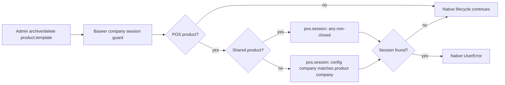

# POS company-scoped product lifecycle guard

**Status:** G0–G3 passed; implementation in progress
**Owner:** Baseer POS
**Delivery unit:** `baseer_pos_company_session_guard`

## Build contract (G0)

Odoo 19's `point_of_sale` product lifecycle guard blocks a POS product's
archive/delete action when **any** `pos.session` is not `closed`; it does not
limit that check to the product's company. The defect was reproduced in the
operational UI: an unused ABROJ-only product was blocked while the open session
was in TEST.

Required behaviour:

| Product/session combination | Required result |
| --- | --- |
| Company A product; only company B session open | Allow archive/delete. |
| Company A product; company A session open | Block with Odoo's native error. |
| Shared product (`company_id=False`) | Any open session blocks. |
| Product not available in POS | No new guard applies. |
| Mixed batch containing a shared product | Any open session blocks. |

Out of scope: changing sessions, TEST, ZATCA, journals, financial documents,
taxes, POS screens, company access rules, or Odoo core. No schema or data
migration is needed.

## Architecture and controls (G1–G2)

The upstream owner is `point_of_sale` on `product.template`:
`_unlink_except_open_session` protects deletion and `_ensure_unused_in_pos`
protects archival. A standalone addon overrides only those two guards, without
calling `super()` (which would repeat the global check).

Its private helper checks `pos.session` using `config_id.company_id` against
`product.template.company_id`. If any selected POS product is shared, it keeps
Odoo's global check; otherwise it makes one existence query limited to the
owning company IDs. It preserves Odoo's `active_test=False` lookup for deleting
an archived POS product and preserves the native `UserError` text.

No accounting, ZATCA, inventory valuation, payment, journal, tax, sequence, or
reconciliation data is read or changed. Same-company and shared-product
protection remain mandatory. The operation is an infrequent administrative
existence lookup, so a new load-test environment is not justified.

The addon depends only on `point_of_sale`, has no fields, ACLs, views, data
files, or assets, and is included in `baseer_pos_suite` for normal deployment.

### Focused component map

**Proven by source/tests:** the two entry points, the `pos.session` state, and
the `pos.config.company_id` relation. **Assumption kept explicit:** production
deployment will use the standard POS-suite upgrade path; no deployment action
is part of this candidate.

## Implementation and verification plan (G3)

1. Implement the isolated inheritance addon and integrate it into the POS
   umbrella package.
2. Test archive/delete for cross-company allowance, same-company blocking,
   shared products, mixed-company batches, non-POS products, and archived POS
   products.
3. Run focused Odoo module tests plus the POS suite packaging test and static
   import/compile checks.
4. Obtain independent delivery review before a release candidate. Deployment
   and TEST-session cleanup are explicitly outside this authorization.

## Independent gate review

**Result: PASS with enforced conditions.** The review confirmed there is no
existing Baseer override of either native guard. It required the two explicit
overrides, `@api.ondelete(at_uninstall=False)`, no `super()` in either guard,
the `active_test=False` delete check, shared-product global protection, the
full behavioural matrix above, and inclusion in `baseer_pos_suite`.
