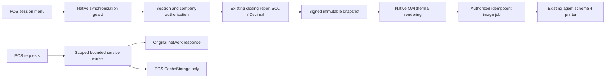

# POS session report and cache resilience — 2026-11-01

## Contract and boundaries (G0)

Owner authorizes exactly two changes: an on-demand report of the **current open POS session**, using the existing closing-report figures, and diagnosis/remediation of browser CacheStorage growth. No daily/company-wide report, customer-default refresh, tax-title change, kitchen change, or Live deployment in this slice. QA verification is authorized. Existing cashier operation, receipts, payments and offline orders must remain intact.

Report: cashier opens the POS menu, requests the session summary, sees/prints paid sales and each payment method up to the server snapshot. Open report is clearly labelled current session / as of; it never closes, posts, balances, or edits the session. Existing closing report stays intact. Refunds and cancelled/draft exclusion retain existing engine semantics. Pending local paid orders or offline status must prevent presenting an incomplete report as complete. Snapshot amounts and rounding remain server SQL numeric/Decimal, Western digits, no browser business calculations.

Cache: screenshot evidence was CacheStorage 377 MB, IndexedDB 1.8 MB and quota 289 MB; after cache-only removal normal operation resumed. Exact cached URL inventory was lost, so attribution of all 377 MB is **not proven**. Native POS worker has unrestricted GET caching and unhandled cache writes; inspect and fix that owned boundary only. Never delete IndexedDB, local/session storage, cookies, unrelated app caches, or unregister service workers. Preserve an offline POS shell and do not claim physical printer/Doha acceptance from automated tests.

## G1 — scope and capacity

Assumption: four active business companies, up to 20 simultaneous cashiers; reports requested manually (normally fewer than one per cashier/minute), one session per request. Existing indexed session filters and bounded aggregate result; no history download or new financial table. Target normal server aggregate under 1 second measured on representative fixture; no production load test or unsupported capacity promise. Cache retention limits must be explicit and tested against small quotas, repeated resources/updates, concurrency and offline reuse. Recovery must leave successful network responses usable when cache storage fails.

## G2/G3 — shortest compatible design (in review)

- Reuse `baseer_pos_print_bridge.models.job._session_close_payload` as the sole financial engine. Public RPC checks POS user, current session ownership/access, active company/config and state before privileged aggregate/printer reads. Server-issued snapshot binds user/session/company/expiry and authoritative values; enqueue validates it and idempotency. No client totals/printer route accepted.
- Keep closed-session enqueue/idempotency behavior unchanged. Reuse existing schema-4 native image transport to the deployed agent with a separate internal session-report job classification; wire image is a receipt raster, not a fiscal invoice. Source session and authoritative snapshot remain auditable. Open report has explicit as-of labels. Existing agent need not be redeployed.
- POS menu uses native Owl/DropdownItem/dialog/printer renderer and existing typography; English/Arabic translations, RTL/LTR, narrow/desktop. No UI library, new framework, AI, or animation. Only feature-local report composition.
- Dedicated small cache-resilience module owns the native POS service-worker override seam. Native core/agent files remain untouched. Final retention algorithm requires independent cache review before code.
- Tests: existing close-report regression, open-session totals vs source/refunds/payment methods, cashier/cross-company/other-session rejection, snapshot tamper/expiry/idempotency, frontend offline/pending/busy states; worker install/activate/fetch/message/quota/update/offline/concurrent cases and original endpoint/auth/scope.

## Gates

| Gate | State | Evidence/reviewer |
|---|---|---|
| G0 | Approved | User scope; independent reviews log 4–5 |
| G1 | Approved | Conservative assumptions; independent reviews log 4–5 |
| G2 | Approved | ERP/report and cache reviewer conditions log 4–5 |
| G3 | Approved | Native Odoo 19 + existing dependencies; no packages; log 4–5 |
| G4 | QA accepted | Desktop and 390px native preview, Arabic raster; log 19 |
| G5–G6 | Source checks passed | PR #609; complete Odoo CI and both Node suites |
| G7 | QA accepted; Live deployed | Protected release41370659381 returned LIVE=GO; log 21 |
| G8 | GO for deployed scope | Independent promotion review plus Live read-only postchecks and matching protected fingerprints; log 20–21 |

## Focused architecture and acceptance map

Confirmed existing boundaries: closing SQL, native renderer, schema-4 queue/agent, native POS worker route. New snapshot/report action and bounded worker are implementation candidates until tested. IndexedDB/orders/payments and unrelated caches have no deletion edge. No new accounting posting path.

Delivery review is focused on changed boundaries only: independent `pos_delivery_review` covers authorization/financial consistency/queue compatibility and cache data safety. Parent runs real Odoo fixtures plus JS lifecycle tests and verifies QA source; physical Doha print output and browser offline acceptance require actual browser evidence and are not inferred from unit tests.

## Operations log (append-only)

1. Read build-team skill and governance/capacity/ERP/architecture/design-catalog references; inspected registry, bridge session/job/print-menu, and approved default-customer work. No application edits.
2. Created isolated branch `codex/pos-session-report-cache-20261101` from refreshed `official/main` at `fa80083b`; unrelated root worktree untouched. Source reviews delegated independently for report/ERP and cache lifecycle.
3. Existing closing SQL uses Decimal aggregates and excludes draft/cancel; closed-session enqueue intentionally closed-only. Existing agent supports native raster transport. Native worker diagnostics identify broad GET caching and unhandled writes; incident byte inventory remains unproven. This document records pre-code design for independent gate review.
4. Independent report/ERP reviewer `session_report_review` approves report G0–G3. Clarifications: existing 80 mm raster printer only; cash denotes cash payments, not counted drawer balance; immutable signed snapshot bound to user/session/request; no recompute on enqueue; original closing uniqueness and order `nb_print` unchanged; refuse incomplete synchronization. Report implementation authorized by these gates. Cache G2/G3 remains under algorithm review.
5. Independent cache reviewer `cache_review` approves cache G0–G3 with conservative algorithm: preserve native `odoo-pos-cache` core/boot, no new runtime-image caching; remove only positively identified legacy product thumbnails (not company/customer/receipt images). Allowlist core and manifest POS boot URLs; serialize/await/catch writes; preserve successful network responses. Inventory bodies sequentially, maximum 128 MiB payload/1024 entries and 32 MiB per-entry on **new writes**; engineering bounds do not equal Chrome disk quota. Keep existing essential entries even over budget and warn of incomplete offline cache. Catch quota, reclaim expendable thumbnails, retry once. Retire old core generations deferred to avoid invalidating existing tabs. No skipWaiting/claim/reload, no other data stores. Cache implementation authorized.
6. Test-environment intent: reuse only the stopped isolated `baseer-operations-fix-db-20261022` with a fresh synthetic test database. New session/report authorization and module/controller integration require real Odoo ORM beyond JS mocks; expected actual usage up to 20 cashiers. No production/shared-QA load tests. Stop the reused database after testing; leave unrelated running containers alone.
7. QA read-only check: current source `2a9df1de08ba26fbf94cba539980a36b0b11ddcd`; protected poller active. Local isolated DB started successfully; unrelated local containers left unchanged. CI extended to run both new Node suites and install/test the cache module alongside guarded POS regressions. No application data or server configuration changed.
8. First real Odoo run: 163 tests, 0 assertions failed, 3 new report fixture errors (native paid-to-draft denial, unconfigured payment method, same-transaction queue timestamp). Implementer corrected fixture setup without weakening production guards. Re-running these three affected cases only. Cache endpoint authentication/scope and report cross-user/company rejection passed. Output logs private under `output/pos-session-cache-odoo-r1.log` and `r2.log`.
9. Corrected fixtures passed: 0 failed/0 errors across all 3 rerun cases; remaining 160 cases passed in r1. Report Node sync/draft/retry/busy suite passed; final cache Node suite 15/15 passed. Independent delivery reviewer verified quota retry fresh-body handling, Vary-aware byte accounting and startup manifest deduplication; no P0/P1 source findings. PR/full fresh CI required next, followed by QA renderer/UI/offline acceptance. Local rerun filestore warnings arose from disposable runner data directory; no operational data involved and no visual acceptance claimed from that run.
10. PR #609 passed all five checks, including the complete Odoo POS suite (run 41311860440), and merged as `78d8203e0c693423eff7a8f1121048848a0806a4`. Independent review authorizes the bounded QA deployment, not Live. Local isolated test database container stopped with data preserved. QA policy updates only the print bridge and installs cache resilience.
11. Protected QA deployment run 41312545404 returned GO; deployed source hashes match. Browser-generated session report job 3758 matches synthetic cash20/bank20/net40/refund1, excludes draft990/cancel880, preserves all order print counters and open session. Raster576x1519/131044bytes inspected; server preparation96.51ms on this small fixture, not physical-printer latency. Natural navigation activated worker2149 and preserved the server-stored draft.
12. QA acceptance exposed unresolved legacy storage: Chrome reports941MB CacheStorage; DevTools odoo-pos-cache contains197entries (76basic/121opaque), displayed content lengths total54895361bytes. Opaque entries comprise120Noto font resources on fonts.odoocdn.com and one Inter stylesheet on fonts.googleapis.com; Chrome documents opaque quota padding (~7MB/entry). Exact Doha incident inventory remains unavailable. Reopen G2 for evidenced legacy-font recovery, not speculative old-core pruning.
13. Independent cache reviewer approves G2 amendment: within odoo-pos-cache only, reclaim HTTPS cross-origin opaque responses on fonts.odoocdn.com/fonts/noto/ or fonts.googleapis.com/css2 for Inter after successful core fetch by the active worker. Preserve unknown hosts/resources, nonopaque responses, same-origin fonts/assets/boot and all other data stores. Pinned native/custom source search confirms only POS worker reads odoo-pos-cache; web worker owns odoo-sw-cache. New scoped worker never serves these foreign font entries. Require negative-control, waiting-worker, quota and browser before/after offline tests. Branch codex/pos-cache-opaque-recovery-20261101 created before edits.
14. Recovery candidate dc388fc6 independently reviewed GO for QA only; all checks passed in PR #613 (Odoo run41314227363), merged71a9dd428513bf775b34653275848eab1fd3876d. Cache tests18/18 include opaque positive/negative paths and forged waiting-worker manifest. Report menu visually accepted at390px and desktop; viewport reset. One read-only aggregate measurement on largest available QA session (57paid orders) took23.09ms; no concurrency or physical-print latency claim. Protected QA recovery policy updates only cache module19.0.1.0.1.
15. QA job3758 snapshot-to-enqueue6.1–7.1seconds exposed unnecessary external webfont embedding during the first report image. Pinned native renderer ignores caller pixelRatio/skipFonts; native exported html-to-image utility supports both. Report reviewer recommends report-only native toHtml/whenMounted/toCanvas with skipFonts and local Segoe UI inheritance, retaining text sanitation. This bounded G2 implementation refinement is approved before edits; global renderer, customer receipts and financial engine remain unchanged. Recheck JPEG limit/Arabic rendering and cold snapshot-to-queue timing on QA. No package or architecture expansion.
16. Owner steered the active task to view without automatic printing. Approved bounded amendment: menu opens a native dialog with the same signed, server-formatted snapshot, optional explicit Print and Refresh. Viewing must work without printer configuration and must never enqueue or rasterize. Separate report access checks from hardware checks; enqueue retains both. Financial engine, synchronization and session state remain unchanged. Branch codex/pos-session-report-preview-20261101 precedes edits. Defer pending fonts-only QA policy #616 so preview and font improvement ship together in one QA cycle.
17. Cache recovery QA deployment41314810522 returned GO. Natural worker2150 activation, then normal fixture POS entry, reduced Chrome CacheStorage941MB to50.0MB; total53.5MB, IndexedDB3.5MB retained. POS cache197entries became77; the121legacy opaque entries disappeared while a new core entry was retained. Draft2602/UUID2be91d84-4a02-59ab-9cd8-dc62054b7c65 remained visible at990.00. No manual cache/storage clear performed.
18. Independent delivery review GO for preview-first source and QA candidate after CI: no P0/P1. Covers read-only preview/refresh, explicit print, snapshot expiry/retry, hardware-independent viewing, preserved access and financial engine. Node behavioral suite passed locally; Windows python launcher unavailable, so compilation and ORM tests remain required in CI. QA acceptance pending for preview/no-queue/optionalprint/390px.
19. Preview PR619 passed all five checks including full Odoo run41316959999, merged9591246ea48a264f67a20e1e2290bfb2375d870a. PolicyPR620/deploy41317648611 returned QA_DEPLOY=GO. Chrome desktop/390px preview and refresh retained jobIDs[3758]; explicit Print alone added3760 on isolated unpaired agent4/printer15. JPEG576x1519/154782bytes visually accepted. Cash20/bank20/sales40/refund1 matched; open draft990/cancel880 excluded; sessionopened and all receipt counters unchanged. Read-only preview without printer passed in rolled-back QA transaction. Server27.88ms on small fixture is not end-to-end latency. Independent delivery acceptance GO for QA; physical paper not tested. Local evidence output/QA-SESSION-REPORT-PREVIEW-20261101.md and adjacent result/image files.
20. Owner authorized one-time Live promotion at2026-11-02 04:00Asia/Riyadh (automation-3). At execution Live sourceae23fc33 already contains accepted feature source but installed bridge is19.0.7.8.26 and cache module absent; no pending module operations. Latestmainccc96bed3947442a83c30acfa4592874b677b7a0 differs from acceptedQA only by policy files and retains later dashboard revert. Independent delivery review GO to pinccc96bed and update/install only bridge19.0.7.8.29/cache19.0.1.0.1 via protected production approval/deploy Actions, paired backup, fingerprints and rollback. Four sessions remain open; no session closure or order/payment edits authorized. Separate native sales-details PDF account.payment ACL defect was confirmed on Live andQA and remains unchanged; do not claim this release fixes it. Deployment completion requires result.env LIVE=GO and postchecks.
21. PR625 passed all required checks and mergedbfb8e164. Protected approval41370559884 succeeded. Deploy41370659381 attempt1 timed out connecting from GitHub SSH before reaching the server; unchanged Live remained running. One retry through the same protected workflow succeeded, LIVE=GO. Release `/srv/abroj-baseer-production/releases/ccc96bed3947-run-41370659381-20261102T010905Z`; paired backup `/srv/abroj-baseer-production/backups/pre-ccc96bed3947-41370659381-20261102T010905Z`. Exact protected-before/after JSON comparison passed. Read-only Live postcheck verified installed bridge19.0.7.8.29/cache19.0.1.0.1, no pending module changes, actual cashier53 open-session preview matching the existing closing engine and payment breakdown, unchanged session and zero new print jobs. Active controller worker SHA25628c086b5b560720cb0d4abe27128a3fe975baa8ced6525c831799402484dda2c; loginHTTP200 and unauthenticated workerHTTP303. QA browser/raster evidence reused because application source unchanged. No physical paper test or fix to the separate native PDF permission issue claimed. Local postcheck evidence output/live-pos-report-cache-postcheck-20261102.txt.
