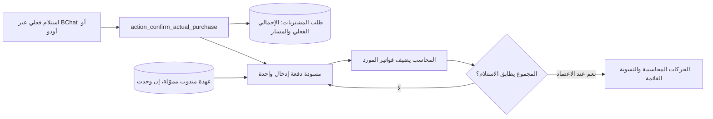

# PROCUREMENT-AUTO-DRAFTS — عقد بناء QA

**التاريخ:** 2026-10-15
**النطاق:** QA فقط. لا نشر حي ولا ترحيل أو تعديل للدفعات القائمة.
**الحالة:** G0–G3 معتمدة للتنفيذ؛ G4 قيد التنفيذ.

## G0 — عقد البناء ودورة العمل

### الهدف

عند تأكيد الكاشير للاستلام الفعلي لطلب شراء، ينشئ الخادم مسودة واحدة فقط في
«دفعات إدخال المشتريات». تظهر للمحاسب فوراً، وتحمل مرجع الطلب والمبلغ الفعلي
ومسار الشراء المسجل في الطلب. لا تنشئ المسودة فاتورة مورّد أو دفعة أو قيداً.

### المستخدمون والرحلة

`طلب → استلام تشغيلي → تأكيد الأسعار/الكميات الفعلية → مسودة دفعة إدخال → المحاسب يدخل المورد والفاتورة → اعتماد → فاتورة/تسوية Odoo الأصلية`.

الكاشير ينشئ الاستلام فقط. خدمة الخادم تنشئ المسودة كمستند تشغيلي قابل للتدقيق.
المحاسب وحده يحرر الفاتورة ويعتمدها. لا يوجد اعتماد أو ترحيل تلقائي.

### البيانات الظاهرة

- رقم الطلب، الشركة، الحالة، وتاريخ الإدخال.
- **مسار الشراء** المحفوظ: مندوب مشتريات، نقد، أو تحويل بنكي؛ هو وصف ثابت ولا
  يغيّر طريقة السداد التي يسجلها المحاسب على الفاتورة.
- إجمالي الاستلام الفعلي من `request.actual_total`، وهو مبلغ المطابقة الإلزامي.
- لمسار المندوب: يعرض إجمالي ما حُوّل من عهدة لهذا الطلب؛ يختار المحاسب مصدر
  «عهدة المندوب» من صف الفاتورة عند إدخالها، ولا يُخترع مبلغ ولا يُخصم شيء عند
  إنشاء المسودة.

### الرقابات المحاسبية

- مصدر الحقيقة للأرقام هو الطلب والعهدة في الخادم؛ الواجهة تعرض فقط.
- مسودة واحدة لكل طلب عبر الرابط الفريد القائم وقفل صف الطلب داخل معاملة
  الاستلام؛ إعادة المحاولة لا تنشئ دفعة ثانية.
- لا تقبل الموافقة أي فرق بين إجمالي فواتير المورد وإجمالي الاستلام الفعلي.
- لا تقبل المسودة الاعتماد بلا صف فاتورة، ولا تُنشأ حركة محاسبية قبل الاعتماد.
- الفاتورة/الدفعة المعتمدة لا تتغير بصمت؛ تبقى مسارات التصحيح الأصلية.

### خارج النطاق

- لا إنشاء تلقائي لمورد أو رقم فاتورة أو ضريبة أو طريقة دفع.
- لا تسوية عهدة عند إنشاء المسودة؛ التسوية فقط مع اعتماد الدفعة وفق المسار القائم.
- لا تحويل دفعات قديمة إلى مسودات تلقائية؛ تُترك سجلاتها بلا تعديل.

### معايير القبول

1. استلام ناجح ينشئ مسودة واحدة مرتبطة بالطلب نفسه، وتبقى `draft` بلا صف فاتورة
   وبلا حركة محاسبية.
2. إعادة تنفيذ التأكيد أو تزامنه لا ينشئان تكراراً.
3. تعرض القائمة والنموذج بالعربية أو الإنجليزية بحسب لغة المستخدم، مع RTL/LTR
   سليم وأرقام غربية.
4. الأعمدة لا تتداخل: رؤوس موجزة، مبالغ ومحاذاة رقمية ثابتة، وعرض مناسب للشاشة
   الضيقة.
5. في مسار المندوب يظهر مبلغ العهدة المحول، ولا يمكن لصف الفاتورة أن يختار غير
   مندوب الطلب؛ النقد والتحويل لا يعرضان عهدة مندوب.

## G1 — السعة والاستمرارية

افتراض محافظ: حتى 10 مستخدمين متزامنين لكل شركة، و50 صف فاتورة كحد الدفعة
القائم، ونمو مئات الطلبات المستلمة شهرياً. الإنشاء يتم في معاملة الاستلام نفسها
وبمفتاح فريد مفهرس (`procurement_request_id`)؛ لا مسح دوري أو RPC جماعي. قائمة
الدفعات تستخدم ترقيم Odoo وتبقى مفهرسة بالطلب/الشركة/الحالة. الهدف: إتمام
الاستلام وإنشاء مسودته ذرياً خلال نفس رحلة المستخدم؛ عند فشل الإنشاء تتراجع
عملية الاستلام كاملة بدلاً من ترك طلب مستلم بلا مسودة.

## G2 — المعمارية والعقود

- نضيف علامة خادمية صريحة لمسودة تلقائية مرتبطة بطلب، تسمح لها فقط بالبقاء بلا
  أسطر قبل إدخال المحاسب، ولا تسمح بذلك للمسودات اليدوية العامة.
- يستدعي مسار `action_confirm_actual_purchase` منشئاً داخلياً ضيقاً بعد التحقق من
  الاستلام، تحت القفل الموجود للطلب. لا يُفتح RPC أو صلاحية إنشاء دفعات للكاشير.
- مسار المندوب يعرض فقط إجمالي حركات التمويل المرتبطة بالطلب والمندوب والشركة؛
  لا يحجز حركة ولا يفرض طريقة دفع. يختار المحاسب مصدر «عهدة المندوب» من صف
  الفاتورة، ويتحقق الخادم من المندوب والرصيد عند الاعتماد.
- الحقول المعروضة مشتقة/مرتبطة وغير قابلة للتعديل: المسار، الإجمالي الفعلي،
  المندوب ومبلغ تحويل العهدة. الحسابات والتقريب في الخادم وبعملة الشركة.
- نضيف اختباراً لوحدة الإنشاء الذري، منع التكرار، عدم وجود `account.move` قبل
  الاعتماد، عرض المسارات الثلاثة، والعزل بين الشركات.

**قرار المسار المباشر:** إعادة استخدام نموذج `baseer.purchase.batch` والرابط
الفريد الموجود لمسودة خادمية محمية؛ لا نموذج طابور جديد ولا مكتبة ولا خدمة
خلفية.

### خريطة المسار المتأثر

مثبت بالدليل: نقطة الدخول في `models/procurement.py` وتجاوز BChat لها، الرابط
الفريد والتحقق عند الاعتماد في نموذج الدفعة، ومسار عهدة المندوب. لا يضاف تكامل
خارجي أو مخزن بيانات أو خدمة خلفية.

## G3 — التقنية والتبعيات

التغيير محصور في `baseer_procurement_requests` فوق رصة Odoo الحالية: Python
للمنشئ والتحقق، XML للقائمة/النموذج/البحث، SCSS صغير عند الحاجة، وترجمات Odoo
عربية وإنجليزية. لا حزمة أو migration أو خدمة خارجية جديدة.

## G4 — تجربة الواجهة

- قائمة الدفعات تعرض الأعمدة بالترتيب المنطقي: الرقم، الحالة، الطلب، المسار،
  الشركة، تاريخ الإدخال، إجمالي الاستلام؛ التفاصيل المالية الثانوية اختيارية.
- تُستخدم تسميات قصيرة، عرض عمود مضبوط ومحاذاة `tabular-nums` للمبالغ، ولا نص
  مقصوص في شاشة سطح المكتب؛ في الجوال يكون النموذج/البطاقات هو رحلة الإدخال.
- صفحة المسودة تبدأ ببطاقة «معلومات الاستلام» تضم الطلب، المسار، الإجمالي،
  والمندوب/العهدة عند انطباقها، ثم صفوف الفواتير. لا حركة متكررة أو عنصر بصري
  منفصل عن مكونات Odoo القائمة.

## دفتر العمليات الحي

| المعرّف/الوقت | البوابة | النوع | النية والدليل | الأثر/التراجع |
| --- | --- | --- | --- | --- |
| PAD-001 — 2026-10-15 | G0 | قرار | اعتمد المالك مسودة تلقائية في دفعات الإدخال بدل قائمة منفصلة؛ راجعنا أن الطلب `PRC/2026/00227` مكتمل ولا يملك دفعة مرتبطة. | لا تغيير بيانات؛ commit واحد قابل للعكس لاحقاً. |
| PAD-002 — 2026-10-15 | G1–G3 | قراءة/اعتماد | فُحصت قيود الدفعة، قفل طلب الاستلام، رابط الطلب الفريد، ومسار العهدة ومصادر أرقامه. لا اعتماد جديد مطلوب. | المسار الذري يقلل خطر المسودات المفقودة أو المكررة. |
| PAD-003 — 2026-10-15 | G4 | قرار | يعتمد العرض قصير العنوان ومحاذاة الأرقام وحالة الجوال/اللغتين، بناءً على صورة المستخدم التي أثبتت تداخل أعمدة القائمة. | لا تغيير بعد؛ يعكس CSS/XML ضمن نفس commit. |
| PAD-004 — 2026-10-15 | G5 | تنفيذ | أضيف منشئ مسودة خادمي محمي، نموذج/قائمة مترجمان، واختبار للذرية ومنع التكرار وعدم إنشاء قيود. | لم يُشغّل اختبار أو نشر بعد؛ التراجع commit واحد بلا بيانات QA. |
| PAD-005 — 2026-10-15 | G6 | تحقق | نجح اختبار Odoo المعزول لمسار النقد ومسار مندوب، بما يشمل عدم إنشاء `account.move` عند الاستلام ومنع التكرار. ونجحت اختبارات واجهة مسارات الطلبات الستة وفحص XML/فرق Git. | قواعد اختبار مؤقتة فقط؛ لم تتغير QA أو اللايف. |
| PAD-006 — 2026-10-15 | G6/مراجعة مستقلة | إصلاح/تحقق | أزيل ربط عهدة الرأس المتعارض؛ صار اختيار العهدة من صف الفاتورة مع مطابقة خادمية لمندوب الطلب. حُمي رابط المسودة من التعديل والحذف، وحُجبت المسودات اليدوية قبل اكتمال الاستلام. نجحت مجموعة اختبار مسار CI محلياً، بما فيها رفض مندوب خاطئ ثم اعتماد المندوب الصحيح. | لا مانع P1 في مراجعة المالية أو الأمن أو التعريب؛ ما زال نشر QA خارج نطاق هذا المرشح حتى تمر فحوص PR. |
