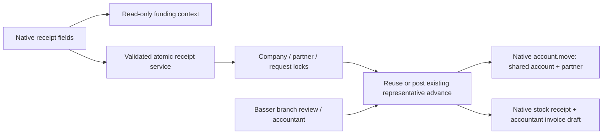

# PROCUREMENT-RECEIPT-CUSTODY-20261104

## Build contract and architecture delta (G0–G3 draft)

Fingerprint: Baseer Odoo, source `9c21f78513aa7ff1c97cd0f274c0e07e03bc8677`, runtime procurement `19.0.14.0.22` / `88229e069f577fa4b5fba2f8836a155e3ab4828c`. Independent branch/worktree `codex/procurement-receipt-custody-20261104`. ARCHITECTURAL: receipt financial side effect and narrow branch role access. Reuse PRA-20260917, accepted receipt cart/full editor and WhatsApp source. Main workspace is unrelated dirty work; untouched.

Owner-authorized workflow: when the restaurant manager/authorized procurement cashier confirms native representative order receipt, require the actual advance amount and the existing approved company bank/cash source. Representative and request reference derive from the request. The same confirmation records the funding and receipt atomically; no extra approval button. Amount is independent of merchandise totals; no default from estimate. Source auto-selects only if exactly one approved source exists. Transfer date is explicit, server-local today by default, editable because this records a transfer already made. At draft creation/send no funding is posted. Add a role-scoped Basser entry for reviewing this restaurant's advances using existing records, not a parallel ledger. Plain POS-only cashier is excluded; the existing branch-operations role remains the authorized cashier/manager.

Accounting: reuse the company's reconcilable current-asset representative account and general journal, debit custody/credit selected existing bank/cash; partner_id is always the request's activated representative. Contact activation only enables selection in the current company, never creates GL accounts or journal entries. Subsequent bills settle from the existing company/representative aggregated balance, not bank again. Invoice/return accounting algorithms and historical entries unchanged. Posted movement corrections remain accountant-controlled; no silent edit/delete. Request link remains a reference, not a new allocation model. Existing posted funding on the same request must be shown read-only and reused, not funded twice. Block missing/invalid source setup and inconsistent representative links.

Scope: native Odoo representative orders only. Cash/transfer/self-purchase routes and BWork internal receipts keep their accepted behavior. Confirm the exact manager_receipt vs cashier final-receipt boundary in specialist review before implementation; never create two advances across both transitions. Historical received/purchased records are not backfilled. Existing manual accountant funding remains supported and is reconciled under the same request lock to avoid a concurrent double funding.

G1 capacity: reuse single-company current operations, assume <=20 concurrent operators, <=1000 purchase requests/month/company and <=2 funding records/request for growth assessment, not a certified load claim. Existing indexed company/request/representative fields, request row lock and representative-balance lock suffice; funding data reads are request-scoped and source list company-scoped. Review entry uses bounded/paginated existing dashboard, no full ledger export. No new local environment or load suite: change requires transactional correctness and competing confirmations, which targeted isolated Odoo/CI tests cover. Preserve existing backup/restore deployment gates; target interactive confirmation seconds, not bulk processing.

G2 proposed contract: one read-only helper returns `receipt_funding` context (`none|required|existing|blocked`, representative name, currency symbol, server today, approved sources, server-formatted existing funding summary/message). Both receipt UI surfaces consume it. Confirmation accepts one optional raw funding object `{amount, cash_journal_id, transfer_date}`; client cannot choose representative/company/account or event IDs. Backend revalidates role, active company, native channel/route, contact eligibility, source, positive Decimal amount <=2 decimals, date/accounting lock, request state, existing funding and idempotency. Funding and receipt/savepoint roll back together on stock/accounting/quantity errors. Existing native form confirmations cannot bypass the requirement; repeated/concurrent confirms never duplicate the entry. No broad accountant/account.move permissions for restaurant operators. No arbitrary-context privilege token. Prefer extension model/file reusing financial posting helper after a narrow server-owned eligibility check.

G3 direct-path decision: extend existing procurement module, existing Odoo19 ORM/native accounting, Owl/core components and Basser item. No new module, library, web service, financial account or copied accounting logic. One local funding fields component shared by receipt surfaces; existing UI styles/components, translations AR/EN, Western digits, mobile/tablet RTL/LTR. Root owns Basser integration/translations/CI/governance; backend worker owns new backend extension + targeted Odoo tests; frontend worker owns catalog JS/XML/SCSS + Node tests. Independent specialist reviews contract and financial/access tests; no overlapping file ownership. No AI/media/migration roles: no corresponding scope.

## Gates

Updated PRA map (source-proven boundaries; load estimates in G1 remain assumptions):

G0–G3: draft, independent accounting/architecture/gate review pending; no application code before approval. G4–G8: not started. Gate reviewer must not approve self-authored evidence. G4 uses existing core Dialog/form controls and module-local shared component; no new design system/library. G5/G6 acceptance: balance and correct partner/request/source, amount differs from goods, existing funding reuse, invalid/missing/overprecision/mis-scoped inputs, period lock, unauthorized POS cashier/read role, direct method bypass, atomic rollback after failure, duplicate and concurrent confirmation, unchanged BWork/nonrepresentative receipts. Backend owns financial totals; UI never computes them. G7 targeted Node + Odoo/roles and required CI. G8 independent alpha-delivery GO then QA read-only actual browser acceptance before protected production release. No real order save/confirm/funding or WhatsApp send during QA/live acceptance.

## Live log

- 01 discovery: user clarified funding recorded at receipt, not create/send, mandatory actual amount and source, same confirm, linked representative and request; shared account/partner design approved. Read-only production confirms company2 account3427 and journal413 configured; no data writes.
- 02 source/provenance: fetched official/main, created isolated worktree at9c21f7851. Root dirty state inventoried but untouched. Read PRA registry and exact receipt/funding/roles/Basser paths; reuse accepted .22 tests where unaffected. Backend/frontend specialists assigned plan-only before gates.
- 03 financial mapping: contact `is_purchase_representative` is company-dependent selection flag only. Existing posting labels both journal lines with `partner_id`, and custody line with funding marker; representative balances use posted marked entries, not individual GL accounts.
- 04 G2 clarification: fund only at FINAL actual receipt confirmation (`sent/received` to `purchased`); separate operational manager handover remains unchanged. Both UI receipt surfaces use one shared fields component. Backend source-of-truth snapshot covers request identity/state/representative, posted request funding and approved payment points; stale changes require reload, never silent overwrite. Exact transport names will be shared by workers before implementation.
- 05 independent G2 blocker: representative lock order is company -> representative -> request (matching manual accountant funding), never request -> representative. Locks alone do not prevent manual funding after automatic funding with a different user token. Proposed additive protected request marker `receipt_custody_confirmed`, false for all historical requests, set only by this new completed native receipt (including reuse). Manual funding under the same locks rejects new funding after that marker, while existing-token retry returns its original record. Pre-receipt manual funding can remain multiple; receipt reuses all valid posted funding and never edits it. No historical unique constraint/backfill; additional post-confirmation funding requires a separately designed explicit workflow and is outside this feature. Both ordering/race cases need isolated concurrency evidence.
- 06 implementation after independent GO: root added Basser branch-manager allowlist/card, existing native menu eligibility, no ACL/accountant grants; read-only dashboard guidance and request reference navigation, request smartbutton, procurement.23/workspace.16. Frontend specialist implemented one shared amount/source/date component in both final receipt screens;51Node cases pass including safe business-error handling. New review card opens existing dashboard with can_record=false. CI workspace scope8 tests; procurement workflow will require explicit ReceiptCustodyCase execution.
- 07 bounded verification discovery: native purchaser-only legacy representative requests block with an actionable contact-selection error rather than creating/mapping contacts silently. Read-only current QA and production counts of sent/received representative requests missing representative_partner_id are both zero, so no active order is stranded. No historical rewrite. Local Windows python launcher unavailable; no install/environment added, existing CI supplies authoritative Odoo validation. Root translated new frontend/workspace copy; live operational data remains untouched.

## Independent G0–G3 gate decision — cart_delivery_review — 2026-11-04

Decision: GO for implementation of the bounded contract and clarifications 04–05. This approves architecture/accounting scope, not the future implementation or release. Reused PRA-20260917 and the accepted native receipt/editor boundaries; no application code changed by the reviewer.

- G0: record an advance already transferred, at FINAL native actual receipt (`sent`/`received` -> `purchased`) only. Operational manager handover does not post funding. Draft/create/send/quote/load never post. No historical backfill or actual operational confirmation during acceptance.
- G1: retain current bounded company/request reads and pagination. Existing isolated CI and QA suffice; no new environment, library or load claim.
- G2 accounting: debit the configured shared reconcilable representative account and credit the approved existing source; company, representative, request and accounts derive server-side. Both move lines carry the same representative partner, and the existing funding marker/history remains authoritative. Amount is independent of goods and must be positive, finite and at most two decimals. Explicit transfer date must pass the existing accounting-period checks. New receipt funding supports company currency only: source journal/account currency must be unset or equal to the company currency; foreign-currency conversion is not silently introduced. Configured account/general journal readiness is mandatory for new posting; source names/IDs are a narrowly scoped read DTO, never general GL access.
- G2 atomicity/concurrency: authorize role and active company BEFORE raw locks; take company -> representative -> request locks before inherited receipt code can lock the request. Re-read identity/route/state/contact and the funding fingerprint after locks; a representative change while waiting is stale, not permission to acquire another representative after the request lock. Use one outer savepoint for funding, final receipt, protected marker and audit. Any stock/accounting/quantity/period failure rolls everything back. Existing posted funding is reused read-only, including multiple historical/pre-receipt records; never decide to re-fund merely because its remaining balance is zero. Missing/unposted/inconsistent accounting links must block reuse rather than appear as valid funding.
- G2 idempotency: the additive `receipt_custody_confirmed` marker is justified to distinguish new final confirmations from historical completed requests. Ordinary create/write/context cannot set or clear it. Both funding paths use the same lock/check; a new manual token after this marker is rejected, an original-token replay returns its original movement, and a manual-first receipt refreshes then reuses existing funding. No new uniqueness constraint over historical request funding and no implicit post-confirmation top-up.
- G2 access/bypass: a server-owned private capability may authorize the exact posting helper only after the validated native receipt boundary; it must not turn a JSON context flag into financial permission. Native direct final-confirm methods must enforce the same requirement; BWork/internal and non-representative paths keep their existing behavior. Branch manager gets only the approved Basser review entry and bounded read-only funding DTO, with `can_record=false`; accountant actions/ACLs remain separately guarded. Plain POS-only cashier is denied. Corrections to posted movements remain accountant-controlled.
- G3: reuse existing Odoo posting and native receipt logic and one module-local shared funding fields component. Do not duplicate ledger, invoice or settlement algorithms. Existing shared partner balance continues to fund later bill settlement, without a second bank credit.

Required acceptance evidence: accounting direction/balance/partner/source/request; amount different from goods; reuse versus missing source; malformed/overprecision/foreign/company/role/lock-date inputs; direct-method/marker/context bypass rejection; rollback after a later native failure; repeated receipt and both manual/receipt race orderings; no ordinary POS or broad GL access; unchanged BWork/non-representative receipts. Final independent source/CI/QA review remains mandatory. No runtime/data writes or tests were performed by this gate review.

### Independent G2 addendum — REPEATABLE READ funding visibility

Endorsed invariant: both race orderings must be safe when the losing transaction has already established its MVCC snapshot before the winner commits. A row lock plus cache invalidation alone cannot reveal a new advance inserted after that snapshot. The manual-funding winner must durably version the shared lock row(s), so the waiting receipt gets a serialization failure and retries against current funding before its fingerprint/reuse decision.

Reuse note: the approved source already does this in `RepresentativePettyCash._lock_request` (`SELECT ... FOR UPDATE`, then `UPDATE baseer_procurement_request SET id = id`) and `_baseer_lock_representative_balance` similarly versions company/partner rows. PostgreSQL's no-op UPDATE creates a new tuple version. Preserve/reuse those existing methods where possible; do not add a redundant metadata UPDATE merely to duplicate this guarantee. A new path that bypasses them or uses SELECT-only locks must explicitly restore a durable version bump under the same company -> representative -> request order. No historical backfill is authorized.

Acceptance must exercise independent-cursor manual-first and receipt-first races with the initial losing snapshot established before the winner commits; verify one funding result/reuse or stale rejection, no extra posted bank credit, preserved receipt atomicity, and rollback/retry behavior. An ordering-only SQL spy is not a substitute for this race evidence.
08 candidate PR672 head7049a66746b4caeeee28823c462e0a8a04e980e3 (280c5c3 implementation +7049a66 test execution metadata/lock period and smartbutton groups). Independent source/G4 review found no remaining blocker; both actual two-cursor race tests use committed isolated UUID fixture under explicit CI flag/database guard and observe Lock wait then serialization/retry, with exactly one funding. Existing Odoo source parsing and five XML files passed;51Node passed. CI41780362941 procurement32cases expected (25existing+7new)/BWork68; workspace41780362900 eight cases; source41780362948 passed. Actual CI/QA still pending. Only changed feature source is frozen; no test/record on sharedQA/live has been confirmed.
09 initial CI41780362941: workspace8 andBWork68 passed, financial runtime exposed fixture mismatches (post_install defaultUSD vsSAR-only auto batch; cash editor quote defaultrep) and a real test setup lock (outerUID1 group update vs independent native company.create updatingUID1company_ids). Cancelled stalled run and proved native cause from installedOdoo source. Test-only fixes: post_install independent-schema execution; early skip customsetUp only for race; explicitSAR in normal/racefixture; cashquote explicit; independentsetup masterdataSU but mark_sent/winner/waiter/retry retain nonSUactor; lock_timeout10s/statement_timeout45s. SourceSCSS min(100%,14rem) also failed LibSass; replaced with single-column minmax(0,1fr) and entirefilecompiled successfully using existingOdooLibSass stdin/noDB. New PO entries now have propercode/model/model_terms occurrences; actualOdooPoFileReader parsed488rows withnewlabels/errors present. 41782048913 financial result31/32 passed (only actor contact creation fixture failed); finalfixture correction75c48b3d83d6526f86e73252afff2fb6f269946b currentCI41782546714. No app backend/financial changes after reviewed280c5c3; no sharedQA/live order confirmations or funding writes.
10 financial G5/G6 GO on finalhead a88ee5d01060d67a950e083a6f726e4061f7b2bd: job126419236460/run41783185360 executes51Node and32Odoo with0failures/errors. Actual INFO markers manual_first at06:08:45.409 and receipt_first at06:08:45.629 prove both real RR ordering/retry cases, exactly one funding each. Root retained output/receipt-custody-qa/receipt-ci-final.log; independent reviewer read it and approved financial evidence. Workspace8/source/contracts pass on samehead; last BWork runtime check pending before merge. Pure fixture fixes also supplied standard/manual cost category and put committed race last to avoid contaminating the outer TransactionCase snapshot; actual actor methods and assertions were not weakened. QA and production unchanged at this point.
11 source PR672 merged as380619e9f82c29db6d86cf248d1ad63886ae392a after all7 checks passed on a88ee5d0:51Node,32procurementOdoo,8workspace,68BWork; bothactualRRmarkers. Independentfinancial/source gatesGO. Release policy baseer-2026-11-04-procurement-receipt-custody pins only procurement19.0.14.0.23 andworkspace19.0.1.0.16. RuntimeQA/browser acceptance and protectedproduction promotion pending; policies do not themselves authorize an unverified activation.
12 .23 QA41784626398 actualGO on380619e9f82c, installedprocurement.23/workspace.16,0pending; recoverySHA256OK. QA838 headercanonical46a8a5f1abdd49e2f95e5d8cfccc221e/5linesced27a3b93e814f48d68af536638faf7 unchanged acrossupgrade/UI,0fundings,markerNULL/false. Realbranch47 SQLREADONLY ORM acceptance: Arabiccardالعهد visible, can_recordfalse, twoapprovedsources/noautoselect; POS42 deniedallthreeentryRPCs. Actualcart UI showsblankamount/source; with validlocalgoodsquote CTAfalse until3500+bank thentrue (notclicked). Captured1024/375,nohorizontaloverflow; resetalllocalquantities/pricesandfundinginputs andviewport. Alternate nativeActualCatalog also showsrequiredfields noJSerror. QAfoundoldheader onlyquantities/price claim nowmisleadingandnewregionEnglisharia. Independentreviewrequiresbounded.24copy/accessibilityamendment: neutralheader +ARIA labelledbytranslatedtitle, uniquepercomponentUUID viaexistinghelper. No accounting/schema/permissions/protocol/CSS change;51Node pass afteramendment, reuseacceptedfinancial32/roles8/BWork68 proofs, requiredCIautomatic. .23 remainsQAonly; noactualsharedorder confirmation/funding orWhatsApptransmission.
