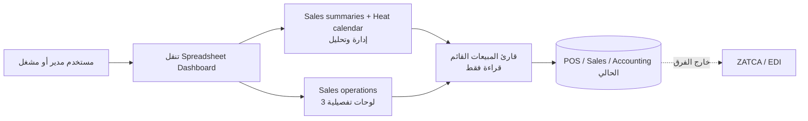

# SALES-DASHBOARD-CONSOLIDATION-20261106

## عقد البناء

**الهدف:** إزالة الالتباس في تنقل لوحات المبيعات لشركة المعلم الشامي: تكون
`ملخصات المبيعات` مع `التقويم الحراري` مسار الإدارة والتحليل، وتبقى لوحات
Sales/POS/POS Restaurant متاحة كمشغلات تفصيلية بأسماء صريحة، من دون أن تظهر
كمنافسة للوحة المدير في المفضلة.

**المستخدمون والرحلات:** مدير المبيعات يفتح الملخص ثم التقويم الحراري؛ مشغل
المبيعات أو الكاشير يفتح لوحة التشغيل المناسبة عند الحاجة. الرحلة الحرجة هي
فتح لوحة المدير ثم التقويم، أو فتح لوحة التشغيل، بلا تغيير في الأرقام أو
مصدرها.

**داخل النطاق:** تسمية/ترتيب/إظهار لوحات المبيعات، والأثر الترجماتي واختبار
التنقل. لوحة المطعم التي تعرض `#ERROR` تعامل كتشخيص منفصل قبل أي تعديل لصيغتها.

**خارج النطاق:** لا حذف للوحـات أو السجلات، لا تعديل لطلبات POS أو جلساته أو
فواتير البيع أو قيود اليومية أو ZATCA أو الضرائب أو الصلاحيات، ولا تغيير لبيانات
QA أو LIVE مباشرة.

**معايير القبول:**

- تبقى لوحة `Sales summaries` و`Heat calendar` لوحتي الإدارة المنشورتين.
- لا تختفي لوحات التشغيل ولا تتغير معادلاتها أو بياناتها؛ فقط تسميتها/موضعها
  المقصود في التنقل.
- لا تكتب الواجهة أي رقم أو أثر مالي؛ مصدر الأرقام الحالي في الخلفية محفوظ.
- تظهر العربية والإنجليزية بصورة سليمة في RTL/LTR وعلى سطح المكتب والجوال.
- يثبت اختبار أن مخطط اللوحات لا يكرر لوحة المدير أو يغير إعدادات POS/ZATCA.

**افتراضات مقيدة:** المقصود من «نفذ» هو تطبيق التنظيم المقترح على QA أولاً؛
إخفاء المفضلة لا يعني حذف لوحة أو منع الوصول التشغيلي. لا ننشر LIVE من هذا
الطلب. لا نعالج `#ERROR` في لوحة المطعم من دون تشخيص صيغة/مصدرها مستقلاً.

### خريطة دورة ERP والرقابة

هذا تغيير عرض وتنقل فقط. دورة البيع الحالية (طلب/جلسة POS أو ملخص معتمد أو
فاتورة → ترحيل محاسبي وفق المسار القائم → ZATCA عند انطباقه) لا تتغير. تظل
القيود والفواتير وسجل التدقيق وسلطات الاعتماد في نماذجها الحالية؛ لا توجد كتابة
على `account.move` أو `pos.order` أو EDI/ZATCA، ولا ترحيل أو عكس أو تسوية.

## سجل البوابات

| البوابة | الحالة | المالك | المراجع المستقل | دليل/قرار |
| --- | --- | --- | --- | --- |
| G0 الحوكمة والعقد | معتمدة | قائد البناء + خبير ERP | حارس البوابات/خبير ERP | مراجعة ERP مستقلة GO: SDC-003 |
| G1 السعة والنمو | معتمدة | مهندس السعة | كبير المعماريين | لا query/RPC جديد؛ تنقل metadata فقط |
| G2 المعمارية والبيانات | معتمدة | كبير المعماريين | خبير ERP | مراجعة معمارية وERP مستقلة GO: SDC-003–004 |
| G3 التقنية والمكتبات | معتمدة | أمين المكتبات | المعماري | Odoo 19/XML وORM القائمان، صفر تبعيات |
| G4 التجربة والواجهة | معتمدة | مصمم التجربة | حارس الجودة | native dashboard navigation + i18n؛ لا حركة مبررة |
| G5 الشريحة الرأسية | معتمدة | البنّاء | حارس الجودة + ERP | 3 اختبارات navigation مركزة: 0 فشل/0 خطأ؛ تعيد التطبيق وتثبت ثبات النشر/الشركات/المجموعات/المفضلة وبصمة المحتوى واللغة المؤرشفة |
| G6 السعة | معتمدة | مهندس السعة | حارس الجودة | لا RPC أو query أو قراءة بيانات جديدة؛ 3 سجلات metadata ومجموعة واحدة فقط، لذا لا مبرر لاختبار حمل |
| G7 البناء | معتمدة | قائد البناء | حارس البوابات | ترقية موديول كاملة على Odoo 19 مع الاعتماديات؛ مجموعة اختبارات الموديول خرجت بنجاح بعد الإصلاحات |
| G8 مرشح التسليم | معتمد للـPR | قائد البناء | فريق تسليم ألفا | GO مشروط بمرور CI ثم QA المحمية وقبول المتصفح |

## ملف السعة والنمو (G1)

لا تزيد الرحلة عدد الصفوف المقروءة أو RPC أو البيانات المنقولة: تغيير metadata
للوحات موجودة فقط. المستخدمون المتزامنون وحجم بيانات المبيعات وسرعة الاستعلامات
غير متأثرة. لا توجد عملية قابلة للتكرار أو كتابة أو هجرة. الحماية التشغيلية هي
النشر المحمي المعتاد ونسخة QA؛ الاستعادة هي rollback المصدر/metadata XML، من دون
استعادة بيانات أعمال.

## قرار المسار المباشر

نُعيد استخدام سجل `spreadsheet.dashboard` والتنقل الأصلي في Odoo بدل بناء لوحة
جديدة أو نسخ مؤشرات. لا مكتبة، ولا نموذج، ولا RPC، ولا طبقة صلاحيات جديدة.
إذا كان Odoo لا يتيح تصنيف «تشغيلي» في القائمة في المصدر المالك من دون تعديل
عريض، يقتصر التغيير على تسمية وترتيب ومفضلة native قابلة للاسترجاع؛ لا حذف أو
إخفاء صلاحيات.

## سجل القرارات

| القرار | البدائل | سبب المسار المباشر | الأثر |
| --- | --- | --- | --- |
| إبقاء اللوحات التشغيلية | حذفها أو تعطيل نشرها | قد تستخدم تشغيل POS؛ الإخفاء من المفضلة أقل مخاطرة وقابل للرجوع | عرض فقط |
| إبقاء `#ERROR` خارج الشريحة | تعديل الصيغ المخالفة فورًا | الصيغ/البيانات قد تكون مالكة لمؤشر تشغيلي؛ يلزم تشخيص مستقل | لا تغيير أرقام |
| QA قبل LIVE | تحرير قاعدة QA مباشرة أو LIVE | المصدر وCI والنشر المحمي يحفظان الأثر وسلسلة التدقيق | لا بيانات مباشرة |

## دفتر العمليات الحي

| المعرّف/الوقت | البوابة | النوع | النية/التغيير | النتيجة والدليل | الأثر والتراجع | المنفذ/المراجع |
| --- | --- | --- | --- | --- | --- | --- |
| SDC-001 2026-11-06 | G0 | قراءة | فحص QA للوحات Sales/POS/Restaurant/Summary | المجموعة تحتوي Dashboards 2/5/6/8؛ المطعم يعرض `#ERROR`؛ الملخص نوع `sales_summary` | قراءة فقط | قائد البناء |
| SDC-002 2026-11-06 | G0–G4 | قرار | اعتماد المسار metadata/native navigation بلا بيانات أو مكتبات | العقد أعلاه؛ مراجعة مستقلة مطلوبة قبل الكود | rollback Git/QA release | قائد البناء |
| SDC-003 2026-11-06 | G0/G2 | مراجعة مستقلة | خبير ERP راجع توحيد المدخل بوصفه عرضًا فقط | GO مشروط بثبات IDs/XML IDs ومصادر الأرقام والصلاحيات؛ لا دمج أو إعادة حساب | لا أثر مالي؛ تجاوز الشرط يعيد G2 إلى المراجعة | خبير ERP / حارس البوابات |
| SDC-004 2026-11-06 | G0–G4 | مراجعة مستقلة | مراجعة المعمارية لمسار Odoo المالك | GO: مجموعة `Operations` جديدة للثلاث لوحات فقط؛ يبقى Sales ومحتواه؛ XML IDs المستهدفة موثقة بالمراجعة | metadata فقط؛ `#ERROR` عائق منفصل | كبير المعماريين / حارس البوابات |
| SDC-005 2026-11-06 | G5 | فشل اختبار | ترقية موديول محلية معزولة رفضت لغة `ar` غير المثبتة عند كتابة ترجمة الاسم | فشل قابل للإعادة؛ لا QA مشتركة أو LIVE؛ سجل Odoo أظهر `Invalid language code: ar` | transaction لم تكمل؛ التصحيح: اكتب الترجمات للغات العربية المثبتة فقط | حارس الجودة |
| SDC-006 2026-11-06 | G5 | فشل اختبار | الاختبار الأولي افترض حقل `data` غير موجود على `spreadsheet.dashboard` | فشل قابل للإعادة؛ Odoo أكد أن المحتوى ليس حقلاً مباشراً في السجل | لا أثر على QA/LIVE؛ الاختبار يحفظ الآن الحقل الأصلي غير الملاحي المتاح فقط | حارس الجودة |
| SDC-007 2026-11-06 | G5 | فشل اختبار | fixture الاختبار حاول تعيين `dashboard_group_id` إلى فارغ وهو حقل native إلزامي | فشل transaction الاختبار فقط؛ لا تأثير QA/LIVE | التصحيح يحاكي النقل من مجموعة Sales الأصلية بدلاً من قيمة غير صالحة | حارس الجودة |
| SDC-008 2026-11-06 | G5 | تحقق مركز | إعادة تطبيق policy مرتين على XML IDs للـSales/POS/Restaurant مع لغتي EN وAR | نجح اختباران/64 query: 0 فشل، 0 خطأ؛ ثبت النقل والأسماء والترتيب وثبات sample path والنشر والشركات والمجموعات والمفضلة | rollback بالمصدر؛ لا تعديل لبيانات الأعمال | حارس الجودة |
| SDC-009 2026-11-06 | G7 | تحقق بناء | ترقية `baseer_sales_dashboard` وتشغيل مجموعته كاملة في قاعدة محلية معزولة وصورة Odoo مثبّتة digest | خرجت المجموعة بنجاح؛ لم يظهر فشل. تحذيرات translate/manifest قديمة خارج الفرق ومسجلة كسياق فقط | لا QA مشتركة أو LIVE؛ لا schema أو بيانات أعمال | قائد البناء |
| SDC-010 2026-11-06 | G5–G8 | إغلاق مراجعة مستقلة | عالجت مراجعتا ERP/المعمارية سياق EN واللغة العربية المؤرشفة وترتيب المجموعة وبصمة محتوى spreadsheet وربط CI | 3 اختبارات/87 query: 0 فشل/0 خطأ؛ المجموعة `sequence=150` بعد Sales، workflow يشغّل `TestDashboardNavigation` | لا تغيير أرقام أو QA/LIVE؛ QA تقبل إلغاء تفضيل المستخدم الحالي يدوياً فقط | حارس الجودة/المعماري/خبير ERP |

## خريطة التسليم المركزة

مرجع الخريطة العام هو `docs/architecture/registry/INDEX.md`؛ هذا الفرق محلي في
واجهة التنقل فقط، ولا يغير حدود الخدمة أو تدفق البيع.

**مثبت:** `dashboard_group_id` و`name` و`sequence` فقط تكتبها الدالة؛ الحقول
`sample_dashboard_file_path` و`is_published` و`group_ids` و`company_ids`
و`favorite_user_ids` مثبتة بالاختبار أنها لا تتغير. **خارج النطاق:** محتوى
spreadsheet، القارئ الموحد، قيود وفواتير البيع وZATCA. لا يوجد API أو جدول أو
اعتماد خارجي جديد.

## مراجعة تسليم ألفا — قبل QA

**العمق:** مركّز. التغيير محصور في تنظيم ثلاثة سجلات metadata مع بيانات مالية
غير قابلة للتعديل؛ المسار عالي الحساسية (المصدر الحسابي/ZATCA) يفحص منع المساس
به بالفرق والاختبار، لا بإعادة تدقيق دورة مالية لم تتغير.

| المراجع | النتيجة | الدليل |
| --- | --- | --- |
| معماري الخريطة / رقيب الجودة / مبسّط البناء | GO | XML ID اختياري وآمن، method idempotent، ولا Owl أو engine أو تكرار لوحة جديدة؛ الترتيب الصريح 150 بعد Sales |
| حارس الأمان والروابط | GO | لا `sudo` أو RPC أو ACL أو اعتماد أو endpoint؛ method داخلي يبدأ بـ`_` ويكتب فقط navigation metadata أثناء upgrade |
| حارس الحقيقة الحسابية | GO | لا تغيير تعريف/تجميع/مصدر القيم؛ sample path والنشر والشركات ثابتة في الاختبار، ولا كتابة account/POS/EDI |
| مختبر الرحلات | GO محلي | 3 اختبارات: نقل الثلاثة، بقاء الملخص/الحرارة في Sales، AR/EN، واللغة المؤرشفة؛ قبول متصفح QA ما زال مطلوباً |
| أمين التشغيل وحارس المرشح | GO مشروط | صورة Odoo المثبتة `sha256:f99ff…c7dd` وقاعدة عزل؛ النشر لاحقاً من commit مدمج وpolicy QA محددة للموديول |
| مهندس السعة | GO | لا مسار طلب/استعلام جديد؛ لا اختبار حمل مبرر وفق G1 |

**ملاحظة مفتوحة P2:** لوحة Restaurant الحالية تعرض `#ERROR`. لم تتغير صيغتها أو
محتواها، ولذلك لا يمنع تنظيم التنقل؛ لكنه يمنع ادعاء أن محتوى تلك اللوحة صالح
حتى يُشخّص في طلب مستقل. لا توجد موانع P0/P1 لهذا الفرق.

**قرار ما قبل QA: GO مشروط** بمرور CI وPR ثم نشر QA المحمي وقبول فتح المجموعة
واللوحات بالعربية والإنجليزية. لا تفويض LIVE ضمن هذا القرار.
