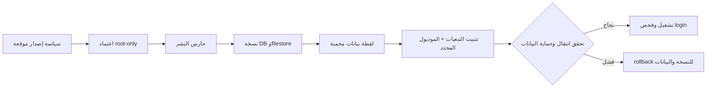

# ZATCA bootstrap guard — 2026-10-25

## النطاق والقرار

مرشح الحارس: `8be93f60` من PR #533، قبل دمج التوثيق الحالي. البيئة المستهدفة
هي حارس نشر Production فقط؛ لا يثبت هذا السجل موديولاً ولا يهيئ شهادة أو دفتر
أو نقطة بيع، ولا ينشئ فاتورة أو اتصالاً خارجياً.

قرار المراجعة المستقلة: **CONDITIONAL GO** لترقية الحارس عبر الآلية المحمية
فقط، بعد نجاح CI للمرشح النهائي. لا تبدأ سياسة bootstrap أو إعدادات Phase 2
إلا في تغيير سياسة مستقل لاحق.

## خريطة المسار

مثبت بالدليل: السياسة تقبل `ZATCA_BOOTSTRAP_RECOMPUTE=1` فقط مع
`baseer_zatca_pos_scope` وحده ولا طرف ثالث؛ ينتقل أربع تبعيات محاسبية من
`uninstalled` إلى `installed`; لا يستثنى من المقارنة إلا `write_date` في
`account.move` و`res.partner.non_user`، فيما تبقى البصمة وعدد السجلات ومجموع
المعرّفات وبقية النماذج متطابقة.

## الأدلة

- CI للمرشح `8be93f60`: Source integrity، BWork cumulative، BWork mobile،
  وBChat cumulative ناجحة.
- اختبار `test-zatca-bootstrap-snapshot.sh` جزء من فحص Production source:
  يقبل تغير وقت التعديل المتوقع ويرفض تغيير بصمة فاتورة أو عميل أو وقت تعديل
  في نموذج آخر.
- ترقية الحارس نفسها مقيدة ببصمة النسخة الحالية والنسخة المرشحة وcommit
  التشغيل المعروف، وتأخذ نسخة root-only وتنفذ rollback عند الفشل.

## حدود مقصودة وخطوات لاحقة

- لا تغيّر هذه المراجعة حالة ARZ أو أي نقطة بيع أو دفتر أو شهادة؛ لا علاقة لها
  بإصدار أو إرسال فاتورة.
- البصمتان تغطيان حقول الأعمال والمالية والتعريفية الأساسية، وليستا تمثيلاً
  شاملاً لكل عمود. هذا خطر تحسين P2 وليس استثناءً مفتوحاً للبيانات.
- بعد دمج الحارس وترقيته بفحص dry-run ثم apply، تنشأ سياسة bootstrap جديدة
  مستقلة ومقيدة بالعلم أعلاه. عندها فقط يجرى النشر المحمي والتحقق اللاحق، ثم
  إعداد الدفاتر والشهادات الإنتاجية بإذن مستقل.
